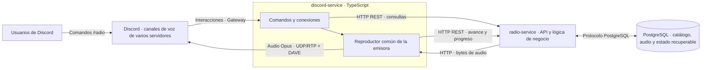

# CC-DASRadio

Plataforma de radio musical automática para Discord. Una emisora selecciona aleatoriamente canciones de su catálogo y comparte la misma reproducción entre los servidores conectados.

El nombre acordado es **CC-DASRadio**. El proyecto se encuentra en el **Hito 1: definición, arquitectura y gestión del desarrollo**; las capacidades siguientes describen el diseño previsto, todavía sin implementación validada.

## Problema y usuarios objetivo

Las comunidades de Discord que quieren escuchar música en grupo necesitan una programación continua sin gestionar manualmente una cola de canciones. CC-DASRadio propone una emisora compartida que mantiene su canción y posición entre conexiones.

Los usuarios objetivo son los participantes de comunidades de Discord y los administradores que habilitan la radio en sus canales de voz. El valor del sistema reside en la programación automática, la reproducción compartida y la recuperación de su estado.

## Alcance del MVP

- Una emisora con un catálogo de canciones almacenado en PostgreSQL.
- Selección aleatoria entre las canciones disponibles al finalizar la canción actual.
- Reproducción común en canales de voz de distintos servidores de Discord.
- Incorporación de nuevos servidores al punto actual de la emisora.
- Consulta del título y artista de la canción actual.
- Desconexión de un servidor sin detener la música para los demás.
- Pausa al desconectarse el último servidor y reanudación al conectarse el primero.
- Conservación de canción, posición y estado para recuperar la reproducción tras reinicios.

Quedan fuera del MVP la transcripción, la IA, YouTube, Spotify, el panel web, las recomendaciones complejas, varias emisoras, jingles y anuncios. Evitar repeticiones recientes será una mejora posterior: la selección aleatoria inicial puede repetir canciones.

Diamond City Radio de Fallout es una referencia posible de programación; el catálogo definitivo está pendiente de elegir y no se incluye todavía contenido musical en el repositorio.

## Comandos y casos de uso

| Comando | Comportamiento previsto |
|---|---|
| `/radio start` | Conecta el bot al canal de voz del usuario. Si es la primera conexión activa, reanuda la emisora; si ya se reproduce, incorpora ese servidor al punto actual. |
| `/radio stop` | Desconecta el bot únicamente del servidor que ejecuta el comando. Si era la última conexión, pausa la emisora y guarda la posición. |
| `/radio now` | Consulta la canción actual y su estado. |

Cualquier usuario puede ejecutar `/radio start` y `/radio stop`, sin exigir un rol administrativo. Stop solo desconecta el bot del servidor solicitante. `/radio now` es una consulta del título y artista actuales y no modifica la emisión.

`/radio skip` queda fuera del MVP para preservar la reproducción común y evitar cambiar la canción para otros servidores. No se añade una reproducción desincronizada por servidor. Los comandos de selección y listado de varias emisoras se reservan para una ampliación.

Flujo de ejemplo:

1. El servidor A conecta el bot: se carga la canción y se reanuda desde la posición guardada.
2. El servidor B conecta el bot: escucha la misma reproducción desde su punto actual.
3. El servidor A desconecta el bot: la música continúa en B.
4. El servidor B desconecta el bot: se pausa y guarda la posición.
5. Una nueva conexión reanuda desde ese punto.

La pausa depende de las conexiones de voz activas del bot, no del número de personas en los canales. La reproducción compartida no garantiza sincronización exacta entre dispositivos: pueden existir diferencias de recepción por la red.

## Arquitectura inicial

### discord-service

Gestiona comandos y conexiones de voz y mantiene un reproductor común para la emisora, con varias conexiones suscritas. Recibe el audio desde `radio-service`, reproduce, informa del progreso y coordina pausa y reanudación.

Solo el controlador del reproductor común solicita el avance al finalizar una canción. Los servidores conectados no seleccionan canciones por separado. Este servicio no accede directamente a PostgreSQL.

### radio-service

Gestiona catálogo, selección aleatoria y estado recuperable de la emisora. Es propietario de PostgreSQL y entrega los bytes del audio mediante su API. Recibe del reproductor las actualizaciones de posición y estado y no contiene lógica de conexión específica de Discord.

### PostgreSQL

Almacena metadatos, archivos de audio binarios y estado recuperable. No se utilizarán Object Storage, MinIO ni Redis en el MVP. El reproductor mantiene su estado operativo en memoria, mientras que los puntos de recuperación se guardan en PostgreSQL mediante `radio-service`.

Los servicios se diseñan para desplegarse independientemente. La separación permite cambiar el cliente de Discord sin modificar el catálogo o la selección musical. El MVP prevé un único controlador de reproducción por emisora; replicar ese controlador requiere coordinación adicional y no basta con lanzar copias independientes.

### Diagrama de componentes y flujos



El audio procede de PostgreSQL a través de `radio-service`. No se devuelven URLs de almacenamiento externo. Las conexiones de voz también requieren señalización WebSocket; el diagrama destaca el flujo de comandos, control y audio.

## Selección musical

Al finalizar una canción, el controlador solicita una selección a `radio-service`. El servicio obtiene las canciones disponibles de la emisora, elige una aleatoriamente, actualiza la canción actual y devuelve sus metadatos. Se propone elegir con igual probabilidad; quedan por concretar el tratamiento de un catálogo vacío y los archivos que fallen al reproducirse.

Seleccionar una canción no demuestra que se haya reproducido: el reproductor confirmará el inicio mediante una actualización de estado. El historial detallado y la exclusión de canciones recientes no son requisitos del MVP.

## Persistencia y audio

Modelo conceptual inicial, pendiente de restricciones y migraciones:

| Entidad | Campos principales |
|---|---|
| `Station` | `id`, `name`, `description`, `enabled` |
| `Track` | `id`, `station_id`, `title`, `artist`, `duration_ms`, `enabled` |
| `TrackAudio` | `track_id`, `content_type`, `data` de tipo `bytea` |
| `StationPlayback` | `station_id`, `current_track_id`, `position_ms`, `status`, `updated_at` |

Separar audio y metadatos evita recuperar los binarios en consultas de catálogo. El formato de audio definitivo y los límites de archivo están pendientes de validación.

Al pausar se guarda la posición; durante la reproducción se guardarán puntos de recuperación periódicos, con intervalo pendiente de definir. Tras un reinicio se reconstruirá el reproductor desde el último punto guardado, aplicando búsqueda temporal o decodificación desde esa posición. La recuperación puede repetir un pequeño tramo si el proceso termina entre dos puntos de guardado.

Las conexiones de voz deben reconstruirse desde Discord; el estado guardado no demuestra que sigan activas tras un reinicio. Quedan pendientes la detección de desconexiones inesperadas, los fallos al guardar y la validación de búsqueda temporal en el audio.

## API REST inicial

Contrato inicial acordado, pendiente de concretar todos los payloads, errores, autenticación, límites y timeouts:

| Método y ruta | Función |
|---|---|
| `GET /health` | Consultar disponibilidad. |
| `GET /api/v1/stations` | Listar emisoras; en el MVP habrá una. |
| `GET /api/v1/stations/{id}/playback` | Consultar canción, posición y estado guardados. |
| `POST /api/v1/stations/{id}/advance` | Seleccionar la siguiente canción y actualizar la programación. |
| `PATCH /api/v1/stations/{id}/playback` | Comunicar posición y cambios de estado. |
| `GET /api/v1/tracks/{id}/audio` | Entregar bytes de audio con el tipo de contenido adecuado. |

Las operaciones de control utilizan JSON; el endpoint de audio devuelve contenido binario. La posición consultada es la última comunicada por el reproductor y puede tener retraso respecto a la reproducción en memoria.

Estado orientativo:

```json
{
  "station_id": 1,
  "current_track_id": 42,
  "position_ms": 65000,
  "status": "paused"
}
```

Actualización orientativa:

```json
{
  "current_track_id": 42,
  "position_ms": 65000,
  "status": "paused"
}
```

El servicio validará que la actualización corresponda a la canción actual. Tras seleccionar una canción deberá distinguirse su carga del inicio efectivo de reproducción; los estados y transiciones definitivos están pendientes.

También quedan pendientes las garantías ante reintentos del avance para evitar seleccionar dos canciones por una misma petición repetida. No se añade WebSocket entre microservicios en el diseño inicial.

## Stack inicial

| Componente | Propuesta | Motivo |
|---|---|---|
| `discord-service` | Node.js, TypeScript, `discord.js` y `@discordjs/voice` | Un reproductor puede distribuir audio a varias conexiones de voz y pausar o reanudar. |
| `radio-service` | Python y FastAPI | API de catálogo, programación y entrega de audio separada del cliente. |
| Persistencia | PostgreSQL | Metadatos, binarios y estado recuperable en una misma base de datos. |

El stack está pendiente de fijar versiones y validar reproducción en dos servidores, compatibilidad de voz y DAVE, carga de binarios y reanudación desde una posición. Los detalles de decodificación y los despliegues en contenedores se concretarán posteriormente.

Referencias de diseño:

- [AudioPlayer y conexiones suscritas](https://discordjs.dev/docs/packages/voice/main/AudioPlayer:Class).
- [Conexión de voz y suscripción al reproductor](https://discordjs.dev/docs/packages/voice/main/VoiceConnection:Class).
- [Datos binarios bytea en PostgreSQL](https://www.postgresql.org/docs/current/datatype-binary.html).
- [FastAPI](https://fastapi.tiangolo.com/).
- [Semántica HTTP](https://httpwg.org/specs/rfc9110.html#safe.methods).

## Entorno de referencia para el Hito 1

El entorno previsto es un servidor doméstico del autor, donde los dos microservicios y PostgreSQL se desplegarán mediante Docker y Docker Compose. No se ha contratado ni seleccionado un proveedor comercial como Azure. En este hito se documenta el entorno; su implementación se reserva para hitos posteriores.

Este entorno permite probar servicios separados, comunicación por red y almacenamiento persistente. Docker por sí solo no acredita todas las características NIST de una nube: el autoservicio de recursos, la medición y los mecanismos de elasticidad deben explicarse como capacidades previstas o limitaciones. El servidor tiene recursos físicos limitados; no se promete elasticidad automática ni sincronización perfecta por añadir contenedores.

Para el mapeo NIST se distinguirán los usuarios consumidores del servicio y el autor como responsable de proveerlo sobre su infraestructura. El operador de red corresponde a la conectividad utilizada; broker y auditor deben analizarse sin inventar organizaciones que no participan. Los papeles no presentes se documentarán explícitamente y, si se propone un escenario futuro, se identificará como hipotético.

## Pendiente para completar el Hito 1

- Confirmar catálogo inicial.
- Completar contratos de API, modelo de datos y tratamiento de fallos.
- Redactar NIST SP 800-145, actores NIST SP 500-292 e impacto económico.
- Documentar ramas y commits; crear plantillas, historias y GitHub Project agrupado por milestones.
- Revisar la entrega contra el enunciado.
