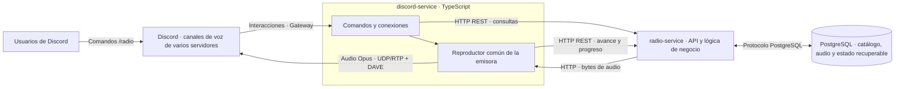

# CC-DASRadio

Plataforma de radio musical automática para Discord. Una emisora selecciona aleatoriamente canciones de su catálogo y comparte la misma reproducción entre los servidores conectados.

El nombre acordado es **CC-DASRadio**. El Hito 1 de definición y arquitectura está cerrado. El **Hito 2: empaquetado, entorno local e integración continua** está en planificación; las capacidades siguientes describen el diseño previsto, todavía sin implementación validada. El [plan del Hito 2](docs/hito-2.md) define tareas, dependencias y evidencias de entrega.

## Problema y usuarios objetivo

Las comunidades de Discord que quieren escuchar música en grupo necesitan una programación continua sin gestionar manualmente una cola de canciones. CC-DASRadio propone una emisora compartida que mantiene su canción y posición entre conexiones.

Los usuarios objetivo son los participantes de comunidades de Discord y los administradores que habilitan la radio en sus canales de voz. El valor del sistema reside en la programación automática, la reproducción compartida y la recuperación de su estado.

## Alcance del MVP

- Una emisora con un catálogo de canciones almacenado en PostgreSQL.
- Selección aleatoria entre las canciones disponibles al finalizar la canción actual.
- Reproducción común en canales de voz de distintos servidores de Discord.
- Incorporación de nuevos servidores al punto actual de la emisora.
- Consulta del título y artista de la canción actual.
- Desconexión de un servidor sin detener la música para los demás.
- Pausa al desconectarse el último servidor y reanudación al conectarse el primero.
- Conservación de canción, posición y estado para recuperar la reproducción tras reinicios.

Quedan fuera del MVP la transcripción, la IA, YouTube, Spotify, el panel web, las recomendaciones complejas, varias emisoras, jingles y anuncios. Evitar repeticiones recientes será una mejora posterior: la selección aleatoria inicial puede repetir canciones.

Diamond City Radio de Fallout es una referencia posible de programación; el catálogo definitivo está pendiente de elegir y no se incluye todavía contenido musical en el repositorio.

## Comandos y casos de uso

La [especificación de casos de uso](docs/casos-de-uso.md) define actores, precondiciones, disparadores, flujos principales, alternativas, postcondiciones y garantías ante fallos. Incluye requisitos funcionales y trazabilidad hacia historias de usuario.

| Caso | Objetivo |
|---|---|
| CU-01 | Iniciar o reanudar la emisora sin conexiones previas. |
| CU-02 | Incorporar otro servidor a la reproducción actual. |
| CU-03 | Detener escucha local y pausar solo al salir el último servidor. |
| CU-04 | Consultar título, artista y estado. |
| CU-05 | Continuar automáticamente la programación al finalizar una canción. |
| CU-06 | Recuperar el último punto guardado tras un reinicio. |
| CU-07 | Supervisar disponibilidad y errores. |

CU-05 es un escenario de soporte disparado por un evento interno; el usuario no ejecuta un comando adicional. Las historias de usuario se utilizarán para planificar el trabajo en GitHub y no sustituyen estos casos.

| Comando | Comportamiento previsto |
|---|---|
| `/radio start` | Conecta el bot al canal de voz del usuario. Si es la primera conexión activa, reanuda la emisora; si ya se reproduce, incorpora ese servidor al punto actual. |
| `/radio stop` | Desconecta el bot únicamente del servidor que ejecuta el comando. Si era la última conexión, pausa la emisora y guarda la posición. |
| `/radio now` | Consulta la canción actual y su estado. |

Cualquier usuario puede ejecutar `/radio start` y `/radio stop`, sin exigir un rol administrativo. Stop solo desconecta el bot del servidor solicitante. `/radio now` es una consulta del título y artista actuales y no modifica la emisión.

`/radio skip` queda fuera del MVP para preservar la reproducción común y evitar cambiar la canción para otros servidores. No se añade una reproducción desincronizada por servidor. Los comandos de selección y listado de varias emisoras se reservan para una ampliación.

Flujo de ejemplo:

1. El servidor A conecta el bot: se carga la canción y se reanuda desde la posición guardada.
2. El servidor B conecta el bot: escucha la misma reproducción desde su punto actual.
3. El servidor A desconecta el bot: la música continúa en B.
4. El servidor B desconecta el bot: se pausa y guarda la posición.
5. Una nueva conexión reanuda desde ese punto.

La pausa depende de las conexiones de voz activas del bot, no del número de personas en los canales. La reproducción compartida no garantiza sincronización exacta entre dispositivos: pueden existir diferencias de recepción por la red.

## Arquitectura inicial

### discord-service

Gestiona comandos y conexiones de voz y mantiene un reproductor común para la emisora, con varias conexiones suscritas. Recibe el audio desde `radio-service`, reproduce, informa del progreso y coordina pausa y reanudación.

Solo el controlador del reproductor común solicita el avance al finalizar una canción. Los servidores conectados no seleccionan canciones por separado. Este servicio no accede directamente a PostgreSQL.

### radio-service

Gestiona catálogo, selección aleatoria y estado recuperable de la emisora. Es propietario de PostgreSQL y entrega los bytes del audio mediante su API. Recibe del reproductor las actualizaciones de posición y estado y no contiene lógica de conexión específica de Discord.

### PostgreSQL

Almacena metadatos, archivos de audio binarios y estado recuperable. No se utilizarán Object Storage, MinIO ni Redis en el MVP. El reproductor mantiene su estado operativo en memoria, mientras que los puntos de recuperación se guardan en PostgreSQL mediante `radio-service`.

Los servicios se diseñan para desplegarse independientemente. La separación permite cambiar el cliente de Discord sin modificar el catálogo o la selección musical. El MVP prevé un único controlador de reproducción por emisora; replicar ese controlador requiere coordinación adicional y no basta con lanzar copias independientes.

### Diagrama de componentes y flujos



El audio procede de PostgreSQL a través de `radio-service`. No se devuelven URLs de almacenamiento externo. Las conexiones de voz también requieren señalización WebSocket; el diagrama destaca el flujo de comandos, control y audio.

## Selección musical

Al finalizar una canción, el controlador solicita una selección a `radio-service`. El servicio obtiene las canciones disponibles de la emisora, elige una aleatoriamente, actualiza la canción actual y devuelve sus metadatos. Se propone elegir con igual probabilidad. Un catálogo vacío impide el avance y devuelve un error explícito; un archivo que falle no se confirma como reproducido y no provoca un bucle ilimitado de selecciones.

Seleccionar una canción no demuestra que se haya reproducido: el reproductor confirmará el inicio mediante una actualización de estado. El historial detallado y la exclusión de canciones recientes no son requisitos del MVP.

## Persistencia y audio

Modelo conceptual inicial, pendiente de restricciones y migraciones:

| Entidad | Campos principales |
|---|---|
| `Station` | `id`, `name`, `description`, `enabled` |
| `Track` | `id`, `station_id`, `title`, `artist`, `duration_ms`, `enabled` |
| `TrackAudio` | `track_id`, `content_type`, `data` de tipo `bytea` |
| `StationPlayback` | `station_id`, `current_track_id`, `position_ms`, `status`, `updated_at` |

Separar audio y metadatos evita recuperar los binarios en consultas de catálogo. El formato de audio definitivo y los límites de archivo están pendientes de validación.

Al pausar se guarda la posición; durante la reproducción se guardarán puntos de recuperación periódicos, con intervalo pendiente de definir. Tras un reinicio se reconstruirá el reproductor desde el último punto guardado, aplicando búsqueda temporal o decodificación desde esa posición. La recuperación puede repetir un pequeño tramo si el proceso termina entre dos puntos de guardado.

Las conexiones de voz deben reconstruirse desde Discord; el estado guardado no demuestra que sigan activas tras un reinicio. Las desconexiones detectadas retiran la conexión del recuento y aplican la regla de última conexión. Si falla el guardado, el punto queda en memoria y se informa; tras una caída solo se recupera el último guardado confirmado. La búsqueda temporal en el audio sigue pendiente de validación.

## API REST

La [especificación REST](docs/api-rest.md) define entradas, respuestas, validaciones y errores. Es un contrato del Hito 1, sin implementación desplegada.

| Método y ruta | Entrada | Salida correcta |
|---|---|---|
| `GET /health` | Sin cuerpo. | `200` con status y disponibilidad de PostgreSQL; `503` si no está preparado. |
| `GET /api/v1/stations` | Sin cuerpo. | `200` con array de emisoras habilitadas. |
| `GET /api/v1/stations/{id}/playback` | ID de emisora. | `200` con canción, posición registrada, estado y metadatos. |
| `POST /api/v1/stations/{id}/advance` | JSON con reason initial o track_finished. | `200` con selección aleatoria, posición 0 y estado loading. |
| `PATCH /api/v1/stations/{id}/playback` | JSON con canción, posición y estado. | `200` con estado actualizado y fecha de guardado. |
| `GET /api/v1/tracks/{id}/audio` | ID de canción. | `200` con bytes y tipo de contenido del archivo. |

Control utiliza JSON; el audio es binario, sin URLs de almacenamiento externo. Las operaciones, salvo health, utilizan una credencial interna propuesta; los usuarios siguen accediendo mediante los comandos de Discord.

Payload de avance:

```json
{
  "reason": "track_finished"
}
```

Payload de progreso o pausa:

```json
{
  "current_track_id": 42,
  "position_ms": 65000,
  "status": "paused"
}
```

Respuesta de consulta orientativa:

```json
{
  "station_id": 1,
  "current_track_id": 42,
  "position_ms": 65000,
  "status": "paused",
  "track": {
    "id": 42,
    "title": "Canción de ejemplo",
    "artist": "Artista de ejemplo",
    "duration_ms": 192000,
    "content_type": "audio/ogg"
  }
}
```

Estados definidos: idle, loading, playing, paused y error. Loading distingue selección e inicio efectivo; la posición es el último punto comunicado y puede tener retraso.

Errores principales: `401` por credencial interna inválida, `404` por recurso inexistente, `409` por catálogo vacío o conflicto de estado, `422` por entrada inválida y `500/503` por fallo interno o dependencia no disponible. Salvo health, siguen el formato:

```json
{
  "error": {
    "code": "empty_catalog",
    "message": "La emisora no tiene canciones disponibles."
  }
}
```

Solo el controlador común realiza el avance. POST advance no se reintenta automáticamente si se pierde la respuesta; se consulta el estado antes de continuar. La deduplicación completa y la coordinación de réplicas se reservarán para implementación. No se añade WebSocket entre microservicios.

## Stack inicial

| Componente | Propuesta | Motivo |
|---|---|---|
| `discord-service` | Node.js, TypeScript, `discord.js` y `@discordjs/voice` | Un reproductor puede distribuir audio a varias conexiones de voz y pausar o reanudar. |
| `radio-service` | Python y FastAPI | API de catálogo, programación y entrega de audio separada del cliente. |
| Persistencia | PostgreSQL | Metadatos, binarios y estado recuperable en una misma base de datos. |

El stack está pendiente de fijar versiones y validar reproducción en dos servidores, compatibilidad de voz y DAVE, carga de binarios y reanudación desde una posición. Los detalles de decodificación y los despliegues en contenedores se concretarán posteriormente.

Referencias de diseño:

- [AudioPlayer y conexiones suscritas](https://discordjs.dev/docs/packages/voice/main/AudioPlayer:Class).
- [Conexión de voz y suscripción al reproductor](https://discordjs.dev/docs/packages/voice/main/VoiceConnection:Class).
- [Datos binarios bytea en PostgreSQL](https://www.postgresql.org/docs/current/datatype-binary.html).
- [FastAPI](https://fastapi.tiangolo.com/).
- [Semántica HTTP](https://httpwg.org/specs/rfc9110.html#safe.methods).

## Entorno de referencia para el Hito 1

El entorno previsto es un servidor doméstico del autor, donde los dos microservicios y PostgreSQL se desplegarán mediante Docker y Docker Compose. No se ha contratado ni seleccionado un proveedor comercial como Azure. En este hito se documenta el entorno; su implementación se reserva para hitos posteriores.

Este entorno permite probar servicios separados, comunicación por red y almacenamiento persistente. Docker por sí solo no acredita todas las características NIST de una nube: el autoservicio de recursos, la medición y los mecanismos de elasticidad deben explicarse como capacidades previstas o limitaciones. El servidor tiene recursos físicos limitados; no se promete elasticidad automática ni sincronización perfecta por añadir contenedores.

Para el mapeo NIST se distinguirán los usuarios consumidores del servicio y el autor como responsable de proveerlo sobre su infraestructura. El operador de red corresponde a la conectividad utilizada; broker y auditor deben analizarse sin inventar organizaciones que no participan. Los papeles no presentes se documentarán explícitamente y, si se propone un escenario futuro, se identificará como hipotético.

## Justificación NIST SP 800-145

Se analiza cómo las características de la nube motivan el proyecto, distinguiendo el diseño del entorno doméstico de sus límites. Docker no acredita por sí solo una nube completa. [Estándar NIST SP 800-145](https://nvlpubs.nist.gov/nistpubs/Legacy/SP/nistspecialpublication800-145.pdf).

| Característica | Aplicación y límite |
|---|---|
| Autoservicio bajo demanda | Start incorpora servidores sin intervención del operador y usa conexiones bajo demanda. El aprovisionamiento automático de infraestructura todavía no está implementado. |
| Acceso amplio a la red | Discord ofrece la interfaz de usuario; API, audio y persistencia se comunican por red. La disponibilidad depende del servidor y su conectividad. |
| Recursos compartidos | Varias comunidades comparten catálogo, base de datos y reproductor; cada conexión añade tráfico y procesamiento. |
| Elasticidad rápida | Los servicios se dimensionan por separado; se prevé estudiar réplicas de API/audio. El controlador compartido necesita coordinación y el servidor doméstico tiene capacidad limitada. |
| Servicio medido | Se prevén conexiones, minutos, peticiones, errores, CPU, RAM, disco y bytes enviados. No se presentan métricas ni facturación como ya implementadas. |

La aplicación tiene orientación SaaS para el consumidor. El despliegue doméstico se considera una simulación; no se declara nube privada NIST plenamente implementada. La [justificación detallada](docs/nist.md) recoge mecanismos previstos y límites.

## Actores NIST SP 500-292

El mapeo es una interpretación del escenario de referencia según el [NIST SP 500-292](https://nvlpubs.nist.gov/nistpubs/Legacy/SP/nistspecialpublication500-292.pdf).

| Actor | Asignación y relación |
|---|---|
| Consumidor | Comunidades y usuarios que utilizan la radio; no administran sus servicios. |
| Proveedor | Autor/operador responsable de ofrecer el servicio sobre su servidor doméstico y mantenerlo. |
| Intermediario / broker | No hay uno independiente. Integrar Discord no convierte automáticamente al proyecto en broker cloud. |
| Auditor | No existe auditor independiente contratado; las pruebas propias y la revisión académica no se presentan como auditoría cloud. |
| Operador de red / carrier | Proveedores de conectividad del servidor y de los consumidores, sin inventar empresas concretas. |

Discord es una plataforma externa. Azure y otros proveedores son alternativas futuras, no actores contratados. Los roles ausentes se identifican expresamente; sus responsabilidades y relaciones económicas se detallan en [el análisis NIST](docs/nist.md).

## Impacto económico

El MVP es un prototipo académico sin cobro. El operador asume electricidad, almacenamiento, conectividad y mantenimiento aunque utilice hardware propio. Los consumidores emplean su conexión para acceder mediante Discord.

Los costes dependen del catálogo, número de conexiones, horas de emisión y recursos medidos. Compartir reproductor evita preparar una programación por servidor, pero requiere enviar audio a cada conexión. Pausar sin conexiones reduce emisión y transferencia; no elimina el consumo base del servidor.

Energía estimada = potencia media medida × horas encendido. Transferencia útil aproximada = bitrate × tiempo × conexiones, con conversión de bits a bytes y overhead adicional. No se atribuyen importes sin medidas y tarifas. El [análisis económico](docs/nist.md) especifica métricas y responsabilidades por actor.

## Gestión del desarrollo

La [guía de contribución](CONTRIBUTING.md) define main estable, ramas feature/docs/fix e integración mediante Pull Requests. Se utilizan commits semánticos de tipo feat, fix, docs, refactor, test y chore.

Están preparadas la [plantilla de historia de usuario](.github/ISSUE_TEMPLATE/user_story.md) y la [plantilla de Pull Request](.github/PULL_REQUEST_TEMPLATE.md). Las historias deben incluir criterios observables, tareas técnicas, etiqueta user-story y trazabilidad a los casos de uso.

El [backlog](docs/backlog.md) contiene ocho historias como Issues reales, con la etiqueta user-story, criterios de aceptación y tareas técnicas. Las [tres tareas del Hito 1](https://github.com/Wid4er/CC-DASRadio/milestone/1) se agrupan en su milestone de definición y gestión. Las historias de funcionalidad permanecen abiertas y pendientes de implementación.

El [Project CC-DASRadio](https://github.com/users/Wid4er/projects/1/views/2) está activo con diecinueve Issues, una vista agrupada por Milestone y los estados Backlog, Ready, In Progress, In Review y Done. Conserva ocho historias funcionales abiertas y tres tareas cerradas del Hito 1. Las ocho tareas técnicas del [Hito 2](https://github.com/Wid4er/CC-DASRadio/milestone/2) enlazan esas historias sin duplicarlas.

La [PR #12](https://github.com/Wid4er/CC-DASRadio/pull/12) integró en main la documentación y las plantillas del Hito 1. Las historias funcionales no se cierran por entregar documentación.

## Entrega del Hito 1 y decisiones posteriores

La entrega incluye definición y alcance, casos de uso formales, arquitectura, persistencia, API REST, NIST, análisis económico y configuración de la gestión en GitHub. La revisión documental verifica ejemplos JSON, enlaces locales, trazabilidad RF/CU y coherencia con el enunciado.

Para los hitos de implementación quedan el catálogo definitivo, versiones del stack, formato y límites de audio, intervalos de guardado, timeouts, deduplicación y pruebas de reproducción y recuperación. Estas decisiones no implican entregar una radio funcional durante el Hito 1.
