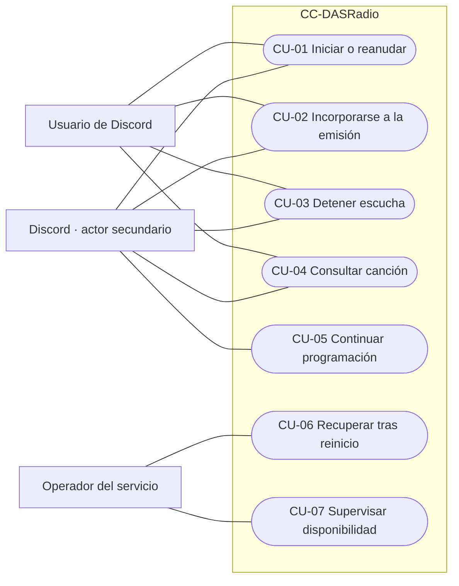

# Casos de uso — CC-DASRadio

Especificación de requisitos del MVP para el Hito 1. El sistema considerado es CC-DASRadio completo: sus microservicios, reproductor y base de datos son componentes internos. Los casos describen comportamiento requerido, no funcionalidad ya implementada.

## Actores y límites

| Actor | Papel |
|---|---|
| Usuario de Discord | Solicita iniciar, detener o consultar la radio. No necesita un rol administrativo. |
| Operador del servicio | Responsable de iniciar o recuperar el despliegue y consultar su disponibilidad. |
| Discord | Sistema externo que entrega interacciones y mantiene las conexiones de voz. |

No se considera al bot como actor externo: forma parte de CC-DASRadio. La finalización de una canción es un evento interno, no un usuario adicional.

## Requisitos funcionales y trazabilidad

| ID | Requisito | Caso de uso | Historia prevista |
|---|---|---|---|
| RF-01 | Cualquier usuario puede iniciar la radio en su canal de voz. | CU-01 | US-01 |
| RF-02 | Un nuevo servidor se incorpora a la reproducción común desde su punto actual. | CU-02 | US-08 |
| RF-03 | Stop desconecta únicamente el servidor solicitante. | CU-03 | US-02 |
| RF-04 | La última desconexión pausa y guarda el punto; la primera conexión posterior reanuda. | CU-01, CU-03 | US-04 |
| RF-05 | El usuario puede consultar el título, artista y estado actuales. | CU-04 | US-05 |
| RF-06 | Al finalizar la canción se selecciona aleatoriamente otra disponible. | CU-05 | US-03 |
| RF-07 | El estado guardado permite recuperar la canción y posición tras un reinicio. | CU-06 | US-10 |
| RF-08 | El operador puede consultar la disponibilidad y los errores operativos. | CU-07 | US-09 |

Reglas comunes:

- Una emisora y una programación compartida; las repeticiones son posibles.
- El MVP prevé una conexión de voz por servidor. No se cambia automáticamente de canal por otra petición de start.
- Start y stop están abiertos a cualquier usuario del servidor; el bot sí necesita permisos de conexión y reproducción.
- Now es una consulta y no exige que el usuario esté en un canal de voz.
- Skip, programación independiente por servidor e historial detallado quedan fuera del MVP.
- La pausa depende de las conexiones del bot, no de cuántos oyentes humanos quedan.
- El estado se conserva en PostgreSQL; no se garantiza sincronización exacta entre dispositivos.

Las reglas de una conexión por servidor y las respuestas a comandos repetidos son decisiones iniciales de diseño para concretar el contrato.

## Vista de casos de uso

Mermaid representa la vista mediante un grafo con casos en elipses y actores fuera del límite; no pretende sustituir una notación UML completa.

CU-05 es un escenario de soporte iniciado por un evento interno. No introduce un comando adicional ni atribuye al usuario una acción que no realiza.

## CU-01 — Iniciar o reanudar la radio

| Campo | Especificación |
|---|---|
| Objetivo | Escuchar la emisora cuando no hay ninguna conexión activa. |
| Actor principal | Usuario de Discord. |
| Actor secundario | Discord. |
| Disparador | `/radio start`. |
| Precondiciones | Bot instalado; comando ejecutado en un servidor; usuario en un canal de voz; bot con permisos; sin conexiones activas de la emisora. |
| Postcondición de éxito | Bot conectado, emisora reproduciéndose y estado de inicio comunicado. |
| Garantía ante fallo | No se confirma reproducción ni se elimina deliberadamente el último punto recuperable. |

Flujo principal:

1. El usuario ejecuta start y el sistema valida el canal y los permisos del bot.
2. El sistema consulta la canción y posición guardadas.
3. Si hay una canción válida, prepara el audio desde esa posición; si no, solicita la primera selección aleatoria.
4. El bot establece la conexión y el sistema inicia el reproductor común.
5. Comunica el inicio efectivo a radio-service y confirma al usuario.

Alternativas y excepciones:

- A1: usuario sin canal de voz o bot sin permisos; se informa del motivo y no se inicia.
- A2: la emisora ya tiene conexiones; se aplica CU-02.
- A3: catálogo vacío o servicio no disponible; se informa y se libera cualquier conexión creada que no pueda recibir audio.
- A4: audio o posición guardada no válidos; se informa y no se promete recuperación. Una política de sustitución del archivo se concretará al implementar.
- A5: peticiones simultáneas de primera conexión se coordinan en el controlador único para no crear dos reproducciones.

## CU-02 — Incorporar otro servidor a la emisión

| Campo | Especificación |
|---|---|
| Objetivo | Escuchar la programación que ya está reproduciéndose. |
| Actor principal / secundario | Usuario de Discord / Discord. |
| Disparador | `/radio start` mientras hay otra conexión activa. |
| Precondiciones | Usuario en un canal válido y bot con permisos; reproductor común activo. |
| Postcondición de éxito | Nueva conexión suscrita al mismo reproductor desde el punto actual. |
| Garantía ante fallo | Las conexiones existentes siguen reproduciendo; no se cambia la canción. |

Flujo principal:

1. El usuario solicita start en su servidor.
2. El sistema valida el canal y establece la conexión de voz.
3. Suscribe esa conexión al reproductor existente.
4. Confirma la incorporación sin seleccionar otra canción.

Alternativas y excepciones:

- A1: el bot ya está en ese canal; se informa de que la radio está activa sin duplicar conexiones.
- A2: el bot está en otro canal del mismo servidor; se informa y se requiere stop antes de cambiarlo.
- A3: conexión rechazada o permisos insuficientes; se informa sin detener los demás servidores.
- A4: la emisión se pausa durante la incorporación; el controlador reevalúa las conexiones y aplica la reanudación de CU-01.

## CU-03 — Detener la escucha de un servidor

| Campo | Especificación |
|---|---|
| Objetivo | Retirar el bot del servidor solicitante. |
| Actor principal / secundario | Cualquier usuario del servidor / Discord. |
| Disparador | `/radio stop`; la pérdida inesperada de una conexión es un flujo alternativo. |
| Precondiciones | Comando ejecutado en un servidor. No se requiere que el usuario esté en voz. |
| Postcondición de éxito | Conexión del servidor retirada; la radio sigue para los demás o queda pausada con el punto guardado. |
| Garantía ante fallo | No se desconectan intencionadamente otros servidores; se informa si no se pudo guardar el punto. |

Flujo principal:

1. El sistema identifica la conexión del servidor solicitante.
2. Retira únicamente esa conexión del reproductor y de Discord.
3. Si quedan conexiones activas, continúa la reproducción común.
4. Si no queda ninguna, pausa, obtiene la posición y solicita guardarla.
5. Confirma la desconexión y, cuando procede, la pausa.

Alternativas y excepciones:

- A1: bot no conectado en ese servidor; se informa sin modificar otras conexiones.
- A2: falla PostgreSQL o radio-service al guardar; el reproductor queda pausado, conserva el punto en memoria y comunica el fallo. Tras un reinicio solo se garantiza el último guardado válido.
- A3: desconexión inesperada detectada por Discord; se retira la conexión del recuento y se aplica la misma regla de última conexión.
- A4: entra otro servidor durante la salida del último; el controlador coordina la transición para no dejar pausada una emisión con conexiones activas.

## CU-04 — Consultar la canción actual

| Campo | Especificación |
|---|---|
| Objetivo | Conocer título, artista y estado de la emisora. |
| Actor principal / secundario | Usuario de Discord / Discord. |
| Disparador | `/radio now`. |
| Precondiciones | Bot instalado y comando ejecutado en un servidor. |
| Postcondición de éxito | Información presentada sin cambiar la canción ni el estado. |
| Garantía ante fallo | La consulta no altera la reproducción. |

Flujo principal:

1. El usuario ejecuta now.
2. El sistema consulta los metadatos y estado de la emisora.
3. Devuelve título, artista y si está reproduciendo, cargando o pausada.

Alternativas y excepciones:

- A1: aún no hay canción; se informa de que no ha comenzado la programación.
- A2: servicio no disponible; se informa de que no puede confirmarse el estado, sin detener audio activo.
- A3: se muestra una posición; se identifica como el último punto registrado, que puede estar retrasado.

## CU-05 — Continuar automáticamente la programación

| Campo | Especificación |
|---|---|
| Tipo | Escenario de soporte con disparador interno. |
| Actor interesado / secundario | Oyentes de la emisora / Discord. |
| Disparador | El reproductor alcanza el final de la canción. |
| Precondiciones | Al menos una conexión activa y catálogo con canciones disponibles. |
| Postcondición de éxito | Otra selección aleatoria empieza en todas las conexiones comunes. |
| Garantía ante fallo | No se registra una selección como reproducción efectiva ni se crean programaciones independientes. |

Flujo principal:

1. El controlador detecta el fin y solicita un único avance.
2. radio-service selecciona aleatoriamente una canción disponible y registra su estado de carga.
3. El controlador obtiene el audio y lo prepara.
4. El reproductor inicia la canción común y confirma el inicio.

Alternativas y excepciones:

- A1: vuelve a salir la misma canción; se admite porque no hay regla antirrepetición en el MVP.
- A2: no quedan conexiones antes de iniciar; se conserva la selección en pausa desde su inicio.
- A3: catálogo vacío, audio no válido o servicio no disponible; se registra un error operativo y se evita un bucle ilimitado de nuevas selecciones.
- A4: respuesta de avance perdida; no se reenvía automáticamente una operación que puede seleccionar otra canción. Se consulta el estado; la estrategia completa de deduplicación queda para implementación.

## CU-06 — Recuperar reproducción tras un reinicio

| Campo | Especificación |
|---|---|
| Objetivo | Recuperar la programación desde el último punto persistido. |
| Actor principal | Operador del servicio. |
| Disparador | Reinicio del despliegue por el operador o recuperación del proceso. |
| Precondiciones | Catálogo y estado anterior disponibles en PostgreSQL persistente. |
| Postcondición de éxito | Canción y punto reconstruibles; al conectarse el primer servidor se aplica CU-01. |
| Garantía ante fallo | No se borran el catálogo o el estado previo por no poder recuperarlos. |

Flujo principal:

1. El operador inicia el despliegue.
2. El sistema consulta la canción y la última posición guardada.
3. Reconstruye un estado local sin asumir activas conexiones del proceso anterior.
4. Espera una conexión de start y prepara la recuperación desde el punto guardado.

Alternativas y excepciones:

- A1: no existe un punto anterior; se comienza una selección al entrar la primera conexión.
- A2: guardado previo marcado playing; no se supone que la canción avanzó durante la caída ni se restaura un recuento antiguo de conexiones.
- A3: posición o archivo incompatibles; se comunica el fallo, pendiente de la política de sustitución.
- A4: fallo entre guardados; puede repetirse el tramo posterior al último punto registrado.

## CU-07 — Supervisar disponibilidad

| Campo | Especificación |
|---|---|
| Objetivo | Conocer la disponibilidad del servicio y detectar errores. |
| Actor principal | Operador del servicio. |
| Disparador | Consulta de estado o revisión operativa. |
| Precondiciones | Acceso a las interfaces internas o logs del despliegue. |
| Postcondición de éxito | Estado de salud y errores disponibles sin modificar la emisión. |
| Garantía ante fallo | La indisponibilidad es comunicada; no se inventan métricas. |

Flujo principal:

1. El operador consulta health y revisa los errores registrados.
2. El sistema informa de disponibilidad y dependencias necesarias.
3. El operador relaciona las incidencias con conexiones y recursos consumidos.

Alternativas y excepciones:

- A1: dependencia no disponible; health devuelve estado no preparado.
- A2: proceso no accesible; el operador trata la ausencia de respuesta como indisponibilidad.
- A3: métricas aún sin instrumentar; se documentan como previstas y no como datos medidos.

## Criterios observables de aceptación

| Caso | Comprobación prevista para hitos de implementación |
|---|---|
| CU-01 | Una canción pausada a 65 s se reanuda desde el punto guardado; sin catálogo se informa del error. |
| CU-02 | B se incorpora sin reiniciar la canción que escucha A; un segundo start no crea otra conexión. |
| CU-03 | Stop en A no interrumpe B; stop en el último canal pausa y solicita guardar. |
| CU-04 | Now devuelve título y artista sin provocar un avance. |
| CU-05 | El fin común produce una única selección, no una por servidor. |
| CU-06 | Tras reiniciar se recupera el punto persistido, no el recuento de conexiones antiguo. |
| CU-07 | Una dependencia caída se distingue de un servicio preparado. |

Los casos de uso especifican interacciones completas. Las historias de usuario serán unidades de planificación en GitHub, con sus propios criterios y tareas; aún no se han creado los Issues.
