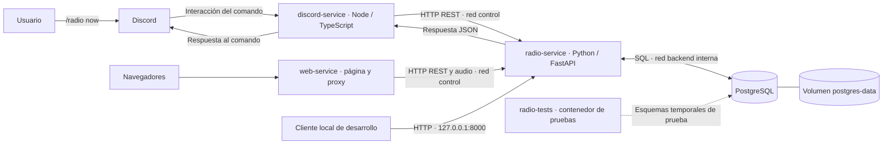

# Estructura de CC-DASRadio

Mapa de la estructura revisada el **11 de noviembre de 2026**. Describe los archivos presentes y su responsabilidad. El proyecto incluye tres microservicios, PostgreSQL, pruebas, contenedores y documentación; incorpora voz en Discord y un reloj común en la API; la prueba audible real se registra aparte de las comprobaciones automatizadas.

## 1. Carpeta de la práctica y repositorio

```text
Practica/
├── CC-DASRadio/              # Repositorio del proyecto: código y documentación pública.
├── Hitos/
│   ├── hito1.md              # Enunciado de definición, arquitectura y gestión.
│   └── hito2.md              # Enunciado de contenedores, entorno local y CI.
├── readme.md                 # Contexto local y decisiones del proyecto.
├── TODO.md                   # Seguimiento local de tareas y decisiones pendientes.
├── push.cmd                  # Utilidad local para commit y push del repositorio.
├── start.cmd                 # Lanzador Windows local del arranque guiado.
├── .hito1-setup/             # Scripts y herramientas auxiliares de preparación de GitHub.
└── .hito2-setup/             # Herramientas portables, scripts y evidencias de desarrollo.
```

Solo **CC-DASRadio/** pertenece al repositorio del proyecto. Los enunciados, el seguimiento local, push.cmd, start.cmd y las carpetas auxiliares quedan fuera. start.cmd delega en scripts/start.ps1, que sí está dentro del repositorio. Las carpetas auxiliares pueden contener configuración local y no son necesarias para ejecutar los servicios con Docker.

## 2. Árbol completo del código y la documentación

Las rutas siguientes son relativas a CC-DASRadio/. Las dependencias descargadas, compilados, cachés y datos de Git se muestran aparte para mantener legible el esquema.

```text
CC-DASRadio/
├── README.md                          # Presentación, arquitectura y acceso a las guías.
├── CONTRIBUTING.md                    # Ramas, commits, PR y criterios de revisión.
├── LICENSE                            # Licencia del proyecto.
├── .gitignore                         # Exclusiones de Git.
├── .gitattributes                     # Finales de línea LF para los scripts Bash.
├── .env.example                       # Variables de ejemplo sin credenciales reales.
├── compose.yaml                       # Servicios, imágenes, redes, healthchecks y volumen.
├── compose.test.yaml                  # Servicio adicional para las pruebas Python.
├── scripts/
│   ├── start.sh                        # Entrada de arranque para Linux (Bash).
│   ├── start.py                        # Web y detección automática del bot; modos explícitos.
│   ├── import-mp3.py                  # Valida con ffprobe y envía MP3 al contenedor API.
│   ├── tests/test_start.py              # Arranque sin Discord y conservación de secretos.
│   └── start.ps1                       # Arranque guiado para Windows (PowerShell).
│
├── .github/
│   ├── ISSUE_TEMPLATE/
│   │   └── user_story.md              # Plantilla de historias con criterios y checklist.
│   ├── PULL_REQUEST_TEMPLATE.md       # Plantilla de entregas y revisión.
│   └── workflows/
│       └── ci.yml                     # Validación automática en GitHub Actions.
│
├── discord-service/                   # Microservicio cliente de Discord: Node.js y TypeScript.
│   ├── Dockerfile                     # Compilación, comprobaciones y ejecución no root.
│   ├── .dockerignore                  # Archivos excluidos del contexto de construcción.
│   ├── package.json                   # Dependencias y comandos npm.
│   ├── package-lock.json              # Versiones e integridad de dependencias Node.
│   ├── tsconfig.json                  # Configuración de compilación y tipos.
│   ├── biome.json                     # Lint y formato del código.
│   ├── src/
│   │   ├── index.ts                   # Inicio del bot y recepción de interacciones.
│   │   ├── config.ts                  # Lectura y validación de variables de entorno.
│   │   ├── commands.ts                # Definición del comando /radio now.
│   │   ├── register-commands.ts       # Registro explícito del comando en un servidor.
│   │   ├── now.ts                     # Consulta, formato y respuesta a /radio now.
│   │   ├── radio-client.ts            # Cliente HTTP de la API, token, timeout y validación.
│   │   └── check-api.ts               # Comprobación cliente-API sin iniciar sesión en Discord.
│   └── test/
│       ├── now.test.mjs               # Respuestas, configuración y tratamiento de errores.
│       └── radio-client.test.mjs      # Peticiones HTTP, errores de respuesta y timeout.
│
├── web-service/                       # Cliente web y proxy del proveedor común.
│   ├── Dockerfile                     # Validación multietapa y runtime no root.
│   ├── package.json                   # Comandos Node y versión fijada de Biome.
│   ├── package-lock.json              # Dependencias de desarrollo con integridad.
│   ├── biome.json                     # Linter y formato de JavaScript.
│   ├── src/
│   │   ├── server.mjs                 # HTTP, página, sesiones y proxy de audio con rangos.
│   │   ├── station.mjs                # Reloj compartido, oyentes, avance y guardado.
│   │   └── radio-client.mjs           # Cliente autenticado de la API; token solo en servidor.
│   ├── public/                        # Radio, tutorial discord.html, CSS y Web Audio.
│   └── test/                          # Pruebas del controlador, HTTP e integración real.
│
├── radio-service/                     # Microservicio de catálogo y estado: Python y FastAPI.
│   ├── Dockerfile                     # Dependencias, aplicación, etapa de pruebas y runtime.
│   ├── .dockerignore                  # Exclusiones del contexto Docker.
│   ├── pyproject.toml                 # Dependencias y configuración de Ruff y pytest.
│   ├── requirements.lock              # Dependencias de ejecución fijadas con hashes.
│   ├── requirements-dev.lock          # Dependencias de desarrollo y pruebas con hashes.
│   ├── radio_service/
│   │   ├── __init__.py                # Identifica el paquete Python.
│   │   ├── app.py                     # FastAPI, rutas, autenticación, validación y errores.
│   │   ├── settings.py                # Configuración de conexión, token y catálogo de prueba.
│   │   ├── database.py                # Conexiones, transacciones y aplicación de migraciones.
│   │   ├── repository.py              # Consultas SQL y operaciones persistentes de la emisora.
│   │   ├── playback.py                # Reloj común, concesiones y puntos de recuperación.
│   │   ├── domain.py                  # Selección aleatoria y reglas de progreso y transición.
│   │   ├── import_audio.py            # Carga transaccional sin duplicados; conserva bytes.
│   │   ├── seed.py                    # Carga idempotente de emisora y tonos WAV generados.
│   │   └── migrations/
│   │       └── 001_initial.sql        # Tablas, relaciones, restricciones e índice inicial.
│   └── tests/
│       ├── test_domain.py             # Reglas del dominio y errores de selección/progreso.
│       ├── test_api.py                # Autenticación, validación, health y formato de errores.
│       └── test_integration.py        # API y PostgreSQL real, audio, concurrencia y persistencia.
│
└── docs/
    ├── reproduccion-compartida.md     # Proveedor, clientes, voz y verificación.
    ├── estructura.md                  # Este mapa del proyecto.
    ├── cargar-musica.md               # Carga local y resultados de la prueba MP3.
    ├── configurar-discord.md          # Tutorial opcional; también servido en /ayuda/discord.
    ├── evaluacion-web.md              # Evaluación sin Discord y límites de la radio web.
    ├── desarrollo-local.md            # Arranque, configuración del bot y ejecución de pruebas.
    ├── api-rest.md                    # Contrato de las seis rutas HTTP.
    ├── casos-de-uso.md                # Actores, requisitos RF, casos CU y trazabilidad.
    ├── nist.md                        # Características, actores y análisis económico.
    ├── backlog.md                     # Historias y tareas con enlaces a GitHub.
    └── hito-2.md                      # Entregables, dependencias y plan del Hito 2.
```

## 3. Archivos locales y generados

Estos elementos pueden aparecer al configurar o desarrollar el proyecto; no son código fuente que deba publicarse:

| Ruta | Función |
|---|---|
| .env | Configuración y credenciales locales; lo genera el primer arranque si falta y se conserva en las siguientes ejecuciones. Excluido de Git. |
| .git/ | Historial y metadatos del repositorio. |
| discord-service/node_modules/ | Dependencias instaladas a partir del lock. |
| discord-service/dist/ | JavaScript generado al compilar TypeScript. |
| radio-service/.venv/ | Entorno virtual de desarrollo Python. |
| __pycache__/, .pytest_cache/, .ruff_cache/ | Archivos temporales de Python y sus herramientas. |

El volumen de PostgreSQL lo gestiona Docker: **no hay una carpeta de canciones ni una carpeta de datos PostgreSQL versionada en el repositorio**. Los binarios de audio se almacenan en la base de datos.

## 4. Componentes en ejecución



| Servicio | Cómo se obtiene | Redes | Activación |
|---|---|---|---|
| postgres | Imagen oficial PostgreSQL fijada por digest. | backend, interna. | Arranque habitual. |
| radio-service | Dockerfile propio, etapa runtime. | backend y control. | Arranque habitual, tras healthcheck de PostgreSQL. |
| discord-service | Dockerfile propio, etapa runtime. | control; salida a Discord. | Perfil discord, con la API preparada y configuración del bot. |
| web-service | Dockerfile propio, etapa runtime. | control. | Predeterminado junto con API y PostgreSQL. |
| radio-tests | Etapa test del Dockerfile Python. | backend. | Solo al ejecutar el Compose de pruebas. |

Hay **tres Dockerfiles propios y cuatro componentes posibles**. Sin credenciales Discord se usan web, API y PostgreSQL; el lanzador añade el bot si detecta sus tres campos completos. --web-only lo omite expresamente. PostgreSQL tiene contenedor propio y usa su imagen oficial. radio-tests es un contenedor adicional temporal de verificación, sin ser un componente permanente del producto.

La API publica su puerto solo en localhost para desarrollo. PostgreSQL no publica un puerto al host y el bot no comparte su red interna.

## 5. Cómo se reparte la lógica

### Una consulta desde Discord

```text
Discord recibe /radio now
    → index.ts reconoce la interacción
    → now.ts prepara la respuesta y solicita el estado
    → radio-client.ts realiza GET /api/v1/stations/{id}/playback
    → app.py valida la credencial y dirige la consulta
    → repository.py consulta mediante database.py
    → PostgreSQL devuelve estado y metadatos
    → now.ts formatea la respuesta
    → el bot responde en Discord
```

command-registration.ts comprueba el registro global al conectar; register-commands.ts permite ejecutar esa comprobación manualmente. check-api.ts permite verificar la parte cliente → API sin registrar comandos ni iniciar sesión en Discord.

### Una operación de la API

```text
Petición HTTP
    → app.py: autenticación, validación y ruta
    → repository.py: lectura o actualización transaccional
    → domain.py: reglas de selección/progreso, cuando corresponda
    → database.py: conexión y transacción PostgreSQL
    → respuesta JSON o bytes de audio
```

domain.py contiene reglas sin acceso directo a Discord o PostgreSQL. repository.py combina esas reglas con las operaciones SQL. database.py también aplica las migraciones versionadas al arrancar.

La carga seed.py genera dos tonos de prueba y no sustituye la canción ni la posición ya guardadas.

## 6. Persistencia

Las entidades conceptuales del diseño se implementan con estos nombres SQL:

| Entidad | Tabla | Contenido |
|---|---|---|
| Station | stations | Emisora, descripción y disponibilidad. |
| Track | tracks | Canciones, artista, duración y emisora. |
| TrackAudio | track_audio | Tipo de contenido y audio binario bytea. |
| StationPlayback | station_playback | Canción seleccionada, posición, estado y fecha de actualización. |
| Control de migraciones | schema_migrations | Versiones SQL ya aplicadas. |

Solo radio-service accede directamente a estos datos durante la ejecución del producto. Las pruebas de integración acceden a PostgreSQL dentro de esquemas temporales propios.

## 7. Construcción, pruebas e integración continua

```text
Código y dependencias bloqueadas
    → Dockerfiles multietapa
    → imágenes de radio-service y discord-service
    → Compose: PostgreSQL, API y cliente opcional
```

El workflow ci.yml realiza:

1. Validación de los manifiestos Compose.
2. Lint de ambos Dockerfiles con Hadolint.
3. Construcción de las imágenes; la de Discord ejecuta tipos, Biome y pruebas Node.
4. Ruff y pruebas Python, incluidas las de PostgreSQL real.
5. Arranque de la API y comprobación de disponibilidad.
6. Consulta desde el contenedor cliente a la API sin credenciales Discord.
7. Prueba de dos oyentes web y audio contra la API y PostgreSQL reales, además de ocho pruebas del lanzador.
8. Limpieza del entorno de pruebas del runner.

**La publicación de imágenes en GHCR sigue pendiente.**

## 8. Estado funcional y ampliaciones pendientes

| Parte | Estado que refleja este código |
|---|---|
| API de catálogo, estado, selección y audio | Implementada. |
| Migraciones y persistencia PostgreSQL | Implementadas. |
| Cliente y manejador de /radio now | Implementados; prueba real en Discord confirmada por el usuario el 2026-11-04. |
| Web y reproducción compartida entre navegadores | Implementadas y verificadas en Firefox; [guía de evaluación](evaluacion-web.md). |
| Dockerfiles, Compose y CI de validación | Implementados; incluyen web-service. |
| /radio start y /radio stop | Implementados; comprobar en un canal real. |
| Voz y reloj compartido | Implementados: reloj en API, AudioPlayer común en Discord; prueba audible real separada. |
| Recuperación desde el punto guardado | Implementada: el cliente obtiene el tiempo actual y prepara Opus desde esa posición. |
| Publicación GHCR | Pendiente. |

La reproducción de voz pertenece a discord-service; la selección, el reloj y la persistencia pertenecen a radio-service. Los módulos nuevos se detallan en la [guía de reproducción compartida](reproduccion-compartida.md).

## 9. Entradas para orientarse

- [README del proyecto](../README.md): visión general.
- [Desarrollo local](desarrollo-local.md): cómo arrancar y probar.
- [Entrada del bot](../discord-service/src/index.ts): recepción de comandos.
- [Cliente HTTP](../discord-service/src/radio-client.ts): comunicación entre servicios.
- [Aplicación FastAPI](../radio-service/radio_service/app.py): rutas y validación.
- [Repositorio de datos](../radio-service/radio_service/repository.py): operaciones SQL.
- [Migración inicial](../radio-service/radio_service/migrations/001_initial.sql): esquema.
- [Compose](../compose.yaml): servicios, redes y volumen.
- [CI](../.github/workflows/ci.yml): comprobaciones automatizadas.

## 10. Proveedor de la emisora y clientes

[La guía web](evaluacion-web.md) detalla las sesiones, el reloj compartido y las pruebas. El proveedor calcula el reloj, selecciona y guarda el progreso; las pestañas y el bot no avanzan por separado. El token interno nunca se entrega al navegador. Web y Discord consumen el mismo estado en directo. La prueba de escucha real en canales Discord se distingue de la integración automatizada.
