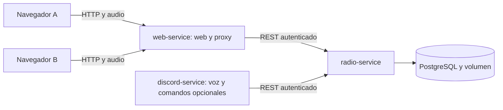

# Evaluación local sin Discord

El cliente web es una **adición opcional de evaluación**: permite comprobar la escucha compartida sin crear una aplicación de Discord ni obtener un token. Discord conserva su papel de interfaz principal prevista. Es una ampliación del Hito 2 solicitada el 4 de noviembre de 2026. Añade `web-service`; el contrato REST original se conserva y se amplía con estado en directo y conexiones. Solo `radio-service` accede a PostgreSQL.

## Arranque

Desde la raíz de CC-DASRadio, con Docker activo y accesible:

```bash
./scripts/start.sh
```

El primer arranque crea `.env` si falta, genera las claves internas y arranca web, API y PostgreSQL. No se completan campos de Discord. Abrir **http://127.0.0.1:8080** y pulsar **Conectar y escuchar**.

En Windows, el equivalente es:

```powershell
powershell.exe -NoProfile -ExecutionPolicy Bypass -File .\scripts\start.ps1
```

Para utilizar Compose directamente, preparar primero `.env` con claves internas propias o dejar que lo cree el lanzador. Con `COMPOSE_PROFILES` vacío, este comando arranca los tres servicios de evaluación:

```bash
docker compose up -d --build --wait
```

`WEB_PORT` permite cambiar el puerto de la web. Un `.env` existente se conserva. Si tiene `COMPOSE_PROFILES=discord`, `docker compose up` incluye también el bot; el lanzador sin opciones detecta los tres campos del bot e incluye Discord si están completos. Para omitirlo expresamente, usar `./scripts/start.sh --web-only` o `-WebOnly` en PowerShell.

Discord sigue disponible con `./scripts/start.sh --discord` o `-WithDiscord` en PowerShell, tras completar las credenciales y registrar `/radio start`, `/radio stop` y `/radio now` como explica la [guía local](desarrollo-local.md). `--api-only` / `-ApiOnly` arranca únicamente API y PostgreSQL.

## Ayuda inicial y tutorial opcional

En el primer arranque se explica el papel de la web y se indica la ruta del [tutorial del bot](configurar-discord.md). Si se solicita el modo Discord y faltan sus campos, el mensaje muestra cómo continuar con la web. Un fallo de arranque con Discord también remite a esa ayuda; no se regenera ni se imprime el token.

En la web hay un desplegable «¿Quieres probar el bot? Configurar Discord es opcional». Permite abrir **/ayuda/discord**, una guía completa con pasos, comandos y una opción para volver a la evaluación web. No hay un asistente obligatorio ni un formulario de credenciales. La ayuda no afirma conocer el estado real del bot: siempre se puede consultar.

El menú incluye **Escuchar**, **Cargar música** (`/ayuda/musica`) y **Configurar Discord** (`/ayuda/discord`). La navegación interna cambia la sección visible y la URL sin sustituir el reproductor, cerrar la sesión ni reiniciar el audio. Atrás y Adelante también conservan la escucha. Las rutas de ayuda se pueden abrir directamente y mantienen los controles de reproducción disponibles.

La guía de música explica requisitos, etiquetas, límite de 32 MiB por MP3, importación individual o múltiple, sustitución opcional de los tonos y persistencia. Consultarla conserva el audio; ejecutar sus comandos de mantenimiento detiene temporalmente los clientes. La carga sigue realizándose desde consola, sin un formulario web de subida.

## Prueba del docente

1. Abrir la web en dos pestañas y pulsar conectar en ambas.
2. Comprobar que ambas muestran la misma canción, un punto de reproducción próximo y dos oyentes. El volumen de cada pestaña es independiente.
3. Desconectar una pestaña: la otra continúa.
4. Desconectar la última: la emisora pausa y guarda la posición.
5. Volver a conectar: se recupera el punto guardado. Al terminar un audio, el servidor selecciona el siguiente para todos.
6. Con música sonando, abrir **Cargar música**, pasar a **Configurar Discord** y volver con el menú o Atrás/Adelante. La sesión, el volumen y el audio siguen activos durante la navegación interna.

El catálogo inicial conserva los **dos tonos WAV generados de un segundo** de la práctica. También se pueden [importar MP3 locales sin recodificarlos](cargar-musica.md); esos archivos quedan en el volumen local y no se distribuyen con el repositorio. Se escucha audio real almacenado en PostgreSQL y entregado por la API; todavía no se incluye un catálogo de canciones musicales. Los tonos cortos permiten comprobar fácilmente los cambios de selección, aunque introducen transiciones frecuentes.

La reproducción empieza con un gesto del usuario y utiliza Web Audio. Los navegadores toleran hasta cinco segundos de diferencia durante una canción. No rebobinan por una respuesta tardía; solo recuperan hacia delante un retraso mayor. Entre canciones, el proveedor mantiene cinco segundos de silencio para precargar y comenzar la siguiente desde su reloj común. No se garantiza sincronización exacta entre dispositivos; influyen la red, la decodificación y el navegador. La política de activación de audio se describe en la [documentación de MDN](https://developer.mozilla.org/en-US/docs/Web/Media/Guides/Autoplay).

## Responsabilidades



- `web-service` es un cliente de la API y gestiona el acceso de sus oyentes web. No consulta PostgreSQL directamente.
- El navegador solo accede a la web. El servidor web conserva `SERVICE_TOKEN` y lo añade a las peticiones internas; no se entrega al navegador ni se incorpora al JavaScript.
- El controlador único de radio-service selecciona el siguiente audio, calcula la posición actual y guarda los puntos de reproducción. Las pestañas no ejecutan `advance` ni escriben el progreso individual en la API.
- Las operaciones del controlador se serializan. Cada selección tiene una identidad propia, incluso cuando la selección aleatoria repite la misma canción.
- El audio se obtiene de la API; la web mantiene una caché acotada a dos audios y atiende rangos HTTP para acceso binario.
- Los oyentes renuevan su sesión mientras están conectados. Al cerrar la página se notifica la salida. Si no llega esa notificación, la sesión caduca a los 45 segundos; un navegador suspendido puede necesitar reconectar.
- Se guarda un punto cada cinco segundos y al salir el último oyente o detener ordenadamente el servicio. Tras una caída se recupera el último guardado confirmado; puede repetirse un tramo.

La imagen web usa Node 24 sobre Bookworm slim fijado por digest, construcción multietapa y usuario 1000 no root. Su contenedor solo comparte la red `control`; publica el puerto web en localhost y elimina capacidades Linux adicionales.

## Límite de esta ampliación

Hay cuatro componentes posibles: PostgreSQL, API, web y Discord. Sin credenciales del bot, la evaluación usa tres y no depende de servicios externos. Con los tres campos Discord completos, el arranque añade el cuarto automáticamente.

El reloj compartido y las concesiones residen en un único proceso de radio-service. No deben lanzarse varios workers o réplicas independientes sin coordinarlo. La web conserva un registro de sus sesiones para controlar el proxy; varias réplicas requieren afinidad o compartir ese registro.

El bot incorpora /radio start, /radio stop y /radio now. Obtiene de la misma API canción, posición y audio. La última conexión, sea web o Discord, pausa la emisión. La [guía de reproducción compartida](reproduccion-compartida.md) describe el protocolo, las pruebas automatizadas y la comprobación audible pendiente en canales reales.

## Verificación

La construcción de la web ejecuta Biome y las pruebas del proxy y del reproductor: continuidad con respuestas tardías, margen de cinco segundos, precarga durante el silencio, cambio de pista, sesiones, HTTP/audio y protección de credenciales. Las pruebas del reloj y la pausa común se ejecutan en la API. Las pruebas del lanzador validan el arranque sin Discord y el modo opcional con bot:

```bash
python3 -m unittest discover -s scripts/tests -v
docker compose build web-service
docker compose up -d --wait web-service
docker compose run --rm --no-deps -v "$PWD/web-service/test:/checks:ro" web-service node /checks/check-live.mjs
```

El último comando comprueba dos oyentes y audio binario contra web, API y PostgreSQL reales. Estos controles se incorporan a CI; no necesitan credenciales Discord.

Verificado localmente el **4 de noviembre de 2026**: construcción, pruebas, integración real y dos pestañas Firefox con Web Audio activo, salida individual, pausa final y vista móvil sin desbordamiento. También se ha probado una copia limpia sin `.env` ni credenciales Discord: generación de configuración y tres servicios saludables. Al recrear los contenedores locales se conservaron canción y posición. La publicación en GHCR sigue pendiente.

Ampliación verificada el **11 de noviembre de 2026**: 13 pruebas web y Biome correctos en Node 24. Firefox con audio real conserva el mismo reproductor y una sola sesión al pasar entre las tres secciones, usar Atrás/Adelante y mantener el volumen; no hubo recargas, reinicios del audio ni errores JavaScript durante la navegación. Comprobados acceso directo a la guía de música y vista de 390 px sin desbordamiento horizontal.

Primera instalación de la versión candidata comprobada el **14 de noviembre de 2026 en Linux/CachyOS**: copia limpia de los archivos publicables, sin `.env`, dependencias locales ni audio personal, con proyecto y volumen PostgreSQL independientes. `./scripts/start.sh` generó claves nuevas en un `.env` con permisos `0600`, mantuvo Discord desactivado y dejó web, API y PostgreSQL saludables. Se aplicaron las dos migraciones y se cargaron exactamente los dos tonos WAV de un segundo; sus bytes y SHA-256 coincidieron con las respuestas de la API. Tras recrear API y web se conservaron catálogo, punto pausado y configuración, sin duplicar pistas.

Firefox decodificó ambos tonos y dos pestañas reprodujeron varias selecciones con el silencio común. Se verificaron la navegación a la guía sin perder la sesión, la continuidad al salir una pestaña y la pausa al salir la última, sin errores JavaScript. Los contenedores, redes y volumen de prueba se eliminaron al finalizar. Esta comprobación corresponde al incremento local candidato a publicación; no acredita una publicación en GitHub ni una prueba del lanzador de Windows. Los dos audios siguen siendo tonos de prueba: todavía no se incluyen dos piezas musicales.

Validación del incremento final del **14 de noviembre de 2026**, ejecutada localmente con asistencia de Codex: **32 pruebas API/PostgreSQL, 23 del bot, 13 de la web y 18 de herramientas**, todas correctas. Se comprobaron Ruff, Biome, TypeScript, construcción de las tres imágenes, sintaxis del workflow con actionlint 1.7.12, comunicación cliente-API y conversión del audio de demostración a paquetes Opus sin conectar a Discord. Una segunda instalación aislada confirmó nuevamente claves nuevas, tres servicios saludables, integridad de los tonos y persistencia sin duplicados; se retiraron sus recursos temporales. La evidencia remota del commit y de los paquetes se registra en [#19](https://github.com/Wid4er/CC-DASRadio/issues/19).
