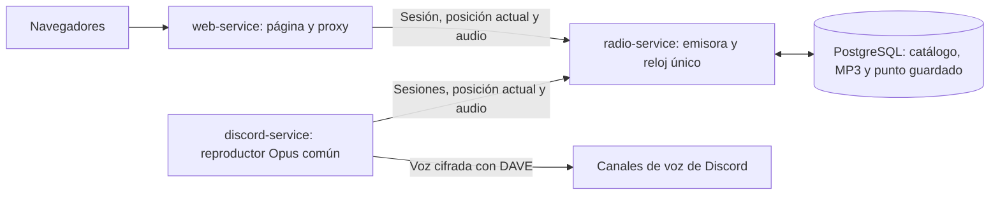

# Emisora compartida por web y Discord

El proveedor **radio-service** mantiene la canción actual, el reloj de la emisora y las conexiones activas. La web y Discord obtienen de esa misma API el audio y la posición actual: no se comunican entre sí ni eligen canciones por separado.

El diseño del Hito 1 situaba el reproductor común en Discord. La primera web de evaluación mantuvo temporalmente su propio reloj. El incremento del 11 de noviembre de 2026 centraliza ese reloj en el proveedor para admitir ambos clientes y permitir que Discord funcione sin desplegar la web. PostgreSQL sigue siendo accesible exclusivamente desde radio-service.

## API del proveedor

Las seis rutas definidas en el Hito 1 se conservan. Se añaden estas operaciones, protegidas por la misma credencial interna:

| Método y ruta | Comportamiento |
|---|---|
| `GET /api/v1/stations/{id}/live` | Canción, posición actual calculada, estado, `playback_id` y conexiones. |
| `POST /api/v1/stations/{id}/listeners` | Alta de conexión, con `{"kind":"web"}` o `{"kind":"discord"}`; devuelve `listener_id` y estado actual. |
| `POST /api/v1/stations/{id}/listeners/{listener_id}/heartbeat` | Renueva la conexión y devuelve el estado actual; `410` si ha caducado. |
| `POST /api/v1/stations/{id}/listeners/{listener_id}/leave` | Retira esa conexión; repetir la salida es inocuo. |

El audio sigue disponible en `GET /api/v1/tracks/{id}/audio`. El endpoint original `/playback` permite consultar el último punto persistido; `/live` añade el tiempo transcurrido con reloj monotónico. Una consulta no crea oyentes ni arranca la música.

La primera conexión reanuda o selecciona una canción. El proveedor avanza una sola vez al terminar, incluso si la elección aleatoria repite el mismo archivo: cada reproducción tiene un `playback_id` diferente. El cliente descarga el audio y vuelve a consultar el tiempo antes de comenzar desde esa posición.

### Cinco segundos de margen y silencio entre canciones

Durante la misma canción, web y bot mantienen el audio continuo con un margen de cinco segundos. Una respuesta tardía no provoca un rebobinado. Solo se recuperan hacia delante retrasos mayores; el siguiente cambio de pista vuelve a anclar ambos clientes al reloj del proveedor.

Cuando termina una canción, radio-service selecciona la siguiente y publica `status: loading`, `position_ms: 0` e `intermission_remaining_ms`, inicialmente 5000. Durante esos cinco segundos comunes los clientes permanecen en silencio y precargan el audio. La web muestra «ENTRE CANCIONES». Al finalizar la espera, el proveedor cambia a `playing` y ambos clientes obtienen su posición actual. No se añade ese silencio al incorporarse inicialmente a una canción que ya está en emisión.

El tiempo de silencio restante se guarda en PostgreSQL mediante la migración `002_intermission`. Si se desconecta el último oyente durante la pausa, se congela ese tiempo; al reanudar se completa lo que faltaba. Esto también se conserva al reiniciar la API.

El guardado periódico toma una muestra de la posición sin reiniciar el reloj monotónico. Se corrigió un defecto que descontaba del reloj el tiempo empleado en guardar cada checkpoint, acumulando retraso y provocando correcciones audibles en los clientes.

Cada pestaña web cuenta como conexión; cada servidor Discord conectado cuenta como una conexión de voz. Se conservan los campos `listeners`, `web_listeners` y `discord_connections` para distinguirlos. Salir de Discord no pausa a la web ni viceversa. Solo la última salida pausa y guarda el punto.

Las conexiones caducan a los 45 segundos sin renovación. Los puntos de recuperación se guardan cada cinco segundos y durante una parada ordenada. Tras una caída se recupera el último punto confirmado, sin restaurar oyentes antiguos. Las escrituras manuales mediante `advance` y `PATCH playback` devuelven `409 playback_owned` mientras el proveedor tenga conexiones activas.

## Comandos de Discord

1. Instalar el bot en el servidor con permisos **Ver canal, Enviar mensajes, Conectar y Hablar**. No necesita Administrator ni intents privilegiados.
2. Registrar de nuevo `/radio` después de actualizar la imagen.
3. Entrar en un canal de voz normal del servidor y ejecutar `/radio start` en un canal de texto.
4. Consultar `/radio now` o salir con `/radio stop`.

Start repetido no duplica la conexión. Para cambiar de canal dentro del mismo servidor, usar stop y después start. Stop solo afecta al servidor que ejecuta el comando y cualquier usuario puede solicitarlo. Los canales de escenario y las llamadas privadas no forman parte de este incremento.

Un único `AudioPlayer` se comparte entre las conexiones de voz. El bot descarga el audio comprimido desde la API y FFmpeg lo convierte al vuelo a Ogg/Opus desde la posición indicada. PostgreSQL conserva los MP3 originales sin recodificación. Se fijan `@discordjs/voice` 0.19.2 y FFmpeg 5.1.9 en la imagen; el lockfile incluye la dependencia DAVE. El runtime sigue ejecutándose como usuario no root.

Fuentes técnicas: [reproductor y varias conexiones](https://discordjs.guide/voice/audio-player), [recursos de audio](https://discordjs.guide/voice/audio-resources) y [voz y cifrado DAVE](https://docs.discord.com/developers/topics/voice-connections).

## Verificación

- Pruebas del proveedor: reloj actual frente a checkpoint, clientes de ambos tipos, avance único, expiración, pausa/reanudación, concurrencia y reinicio.
- Pruebas del cliente web: proxy, aislamiento de sesiones, audio HTTP y cierre sin desconectar a Discord.
- Pruebas del bot: varios servidores con un recurso, start idempotente, cambio de canción, fallos y recuperación de concesiones.
- `node dist/check-voice.js` dentro de la imagen comprueba API, conversión a Opus y disponibilidad de DAVE/AES sin enviar audio a Discord; también se ejecuta en CI.
- La comprobación real de voz requiere ejecutar start en un canal y escuchar: las pruebas anteriores no acreditan por sí solas la recepción audible ni una escucha manual en varios servidores.

Validación local del 11 de noviembre de 2026: **29 pruebas Python/API/PostgreSQL, 17 del bot, seis de la web y 13 de herramientas**; Ruff, Biome, TypeScript, Hadolint y construcción de las tres imágenes correctos. La integración real confirmó que web y una conexión de tipo Discord comparten reproducción y reloj, y que salir de la web conserva la emisión del otro cliente. La conversión de un MP3 del catálogo a paquetes Opus y la carga de las dependencias DAVE/AES pasaron sin conectar a un canal de voz. Firefox reprodujo la misma canción en dos pestañas y verificó salida individual, pausa final y reanudación sin errores JavaScript. La actualización de los contenedores conservó canción y posición; el catálogo de la prueba permaneció en su volumen local.

La instalación Guild y el registro de `/radio start`, `/radio stop` y `/radio now` quedaron confirmados mediante la API de Discord el 11 de noviembre de 2026. El servidor configurado coincide con la instalación del bot. Se actualizó el comando `/radio` que solo conservaba `now`; no se sustituyeron otros comandos de la aplicación. La prueba audible real en un canal y la escucha manual en varios servidores siguen pendientes.

Ese mismo día se corrigió el alcance del registro: `/radio` es ahora global y está disponible en todos los servidores donde se instala el bot con `applications.commands`, sin cambiar `DISCORD_GUILD_ID` ni registrar cada servidor por separado. Al conectar, el bot compara la definición y solo publica cambios si hacen falta. Se verificó mediante la API de Discord la definición global con start/stop/now y contexto exclusivo de servidor en las dos instalaciones existentes; se retiró la antigua copia local de `/radio`, conservando los demás comandos. Las **23 pruebas del bot**, incluidas cuatro del registro global, pasaron junto con tipos y Biome. [Referencia de alcance global](https://docs.discord.com/developers/interactions/application-commands#making-a-global-command).

Verificación posterior de la corrección de audio y la pausa común: **32 pruebas API/PostgreSQL, 19 del bot, 11 de la web y 13 de herramientas**, todas correctas. Se reprodujeron antes de corregirlos el retraso acumulado por checkpoints lentos y los reinicios del reproductor ante respuestas tardías. En Firefox, dos pestañas permanecieron en silencio durante la pausa común (4992 ms restantes anunciados, 5073 ms observados hasta `playing`), precargaron y reprodujeron la siguiente pista. En otra prueba con MP3, durante 25 segundos y 38 consultas con una demora de 800 ms cada tres respuestas, hubo **cero reinicios del recurso de audio y cero errores JavaScript**. El entorno de tonos de esta prueba fue independiente y se eliminó al terminar. La migración y la integridad del catálogo local se comprobaron después de actualizar. Los archivos personales no se distribuyen.

## Límites actuales

El reloj vive en un único proceso de radio-service; no se deben lanzar varios workers o réplicas independientes de esa API sin coordinarlo. El bot mantiene un único reproductor por emisora. La web conserva un registro local de sus sesiones, por lo que varias réplicas requieren afinidad de sesión o compartir ese registro. No se promete sincronización exacta entre dispositivos: el cliente se incorpora al tiempo del proveedor y corrige desviaciones de reproducción, con latencia de red y decodificación.
